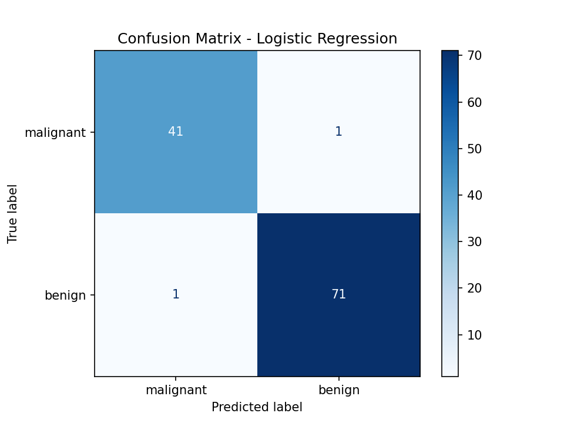
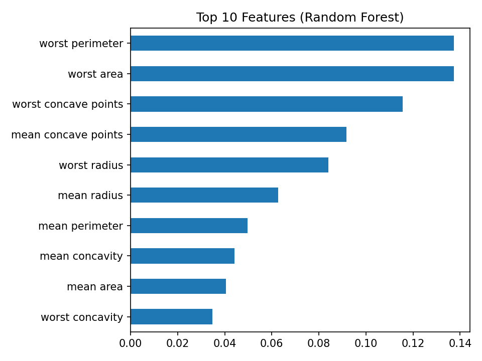

# Disease Prediction from Medical Data

Machine Learning internship project (CodeAlpha) that predicts whether a breast tumor is malignant or benign from medical measurements.

## Problem
Given measurements of a cell nucleus (radius, texture, perimeter, area, concavity, etc.), classify the tumor as **malignant** (cancerous) or **benign** (non-cancerous).

## Dataset
Breast Cancer Wisconsin (Diagnostic) dataset, loaded via `sklearn.datasets.load_breast_cancer` (UCI ML Repository): 569 patients, 30 numeric features. 212 malignant and 357 benign.

## Approach
1. Loaded and explored the data
2. 80/20 stratified train-test split (455 train, 114 test)
3. Feature scaling with StandardScaler (inside a Pipeline, so no data leakage)
4. Trained 3 models: Logistic Regression, SVM, Random Forest
5. Evaluated with Precision, Recall, F1-Score, ROC-AUC and a confusion matrix
6. Analyzed the most important features using Random Forest

## Results

Precision, Recall and F1 are weighted averages on the 114-row test set. "Malignant Recall" is the share of actual malignant tumors the model caught.

| Model | Accuracy | Precision | Recall | F1-Score | ROC-AUC | Malignant Recall |
|-------|----------|-----------|--------|----------|---------|------------------|
| Logistic Regression | 0.98 | 0.98 | 0.98 | 0.98 | 0.995 | 0.98 |
| SVM | 0.98 | 0.98 | 0.98 | 0.98 | 0.995 | 0.98 |
| Random Forest | 0.95 | 0.95 | 0.95 | 0.95 | 0.994 | 0.93 |

### Confusion Matrix


### Feature Importance


## Conclusion
Logistic Regression and SVM performed best, both with 98% accuracy and a ROC-AUC of 0.995, and both caught 98% of malignant tumors. Random Forest was slightly behind at 95% accuracy and 93% malignant recall. In disease prediction, missing a malignant case (false negative) is the costliest error, so recall on the malignant class is the most important metric here. Features related to the "worst" tumor size and shape (perimeter, area, concave points) were the strongest predictors.

Note: this is a learning project on a small dataset and is not a medical diagnostic tool.

## How to run
```bash
pip install -r requirements.txt
jupyter notebook disease_prediction.ipynb
```

## Author
Saksham Sharma
